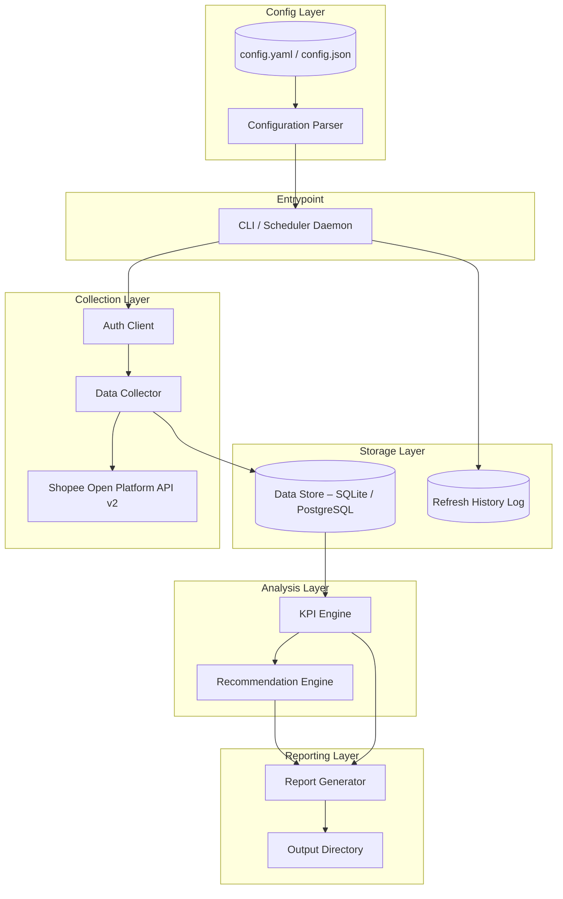

# Design Document: Shopee Sales Analyzer

## Overview

The Shopee Sales Analyzer is a Python application that connects to the Shopee Open Platform API v2 to retrieve seller account data, computes sales KPIs and per-product metrics, generates actionable recommendations, and exports structured data compatible with a pre-built Power BI template. The system is driven by a YAML/JSON configuration file and supports scheduled data refreshes (hourly, daily, or weekly) via APScheduler.

### Design Goals

- Clean separation between data collection, analysis, recommendation, and reporting concerns
- Resilient API integration with automatic retry and token refresh
- Reproducible, testable pure-function analytics layer
- Star-schema CSV exports that load into a pre-shipped `.pbit` template without manual mapping
- Structured, leveled logging with a per-run summary

### Technology Choices

| Concern | Choice | Rationale |
|---|---|---|
| Language | Python 3.11+ | Broad data/analytics ecosystem, YAML/JSON support, strong typing via dataclasses |
| HTTP client | `requests` with retry adapter | Mature, well-understood; HMAC-SHA256 signing via `hashlib` |
| Scheduling | APScheduler 3.x (`BackgroundScheduler`) | Supports interval and cron triggers; no external broker required |
| Configuration | PyYAML + `pydantic` v2 | Schema validation, typed models, round-trip serialisation |
| Data storage | SQLite via `sqlite3` (default) / PostgreSQL via `psycopg2` (optional) | Zero-setup for individual sellers; pluggable for teams |
| Logging | Python `logging` + `python-json-logger` | Structured JSON log entries; configurable verbosity |
| Report export | `csv`, `json` stdlib + `pandas` for Power BI CSV generation | Deterministic column ordering |
| Testing | `pytest` + `hypothesis` | Property-based testing with the Hypothesis library |

---

## Architecture

The application follows a layered pipeline architecture. Each layer communicates through well-defined data models, keeping external I/O isolated from the pure analytical logic.



### Pipeline Execution Flow

1. **Startup**: CLI reads and validates the configuration file.
2. **Authentication**: Auth Client performs OAuth 2.0 token acquisition or refresh.
3. **Collection**: Data Collector paginates through orders and products for the requested Sales_Period, persisting records to the Data Store.
4. **Analysis**: KPI Engine reads persisted records and computes all metrics (pure functions, no I/O).
5. **Recommendation**: Recommendation Engine applies trigger rules to analysis output (pure functions).
6. **Reporting**: Report Generator serializes KPI results, recommendations, and star-schema tables to files.
7. **Summary**: Run summary is logged and printed.

---

## Components and Interfaces

### 1. Configuration Parser

Reads a `config.yaml` or `config.json` file and produces a validated `Configuration` dataclass. Also serialises a `Configuration` back to YAML/JSON (used for initialising a default config and for the round-trip property).

```python
class ConfigurationParser:
    def parse(self, path: Path) -> Configuration: ...
    def print_config(self, config: Configuration, path: Path) -> None: ...
```

### 2. Auth Client

Handles Shopee Open Platform OAuth 2.0 flows. All requests to Shopee v2 require HMAC-SHA256 request signing using the pattern:

```
sign = HMAC-SHA256(partner_key, f"{partner_id}{api_path}{timestamp}{access_token}{shop_id}")
```

The Auth Client stores tokens in the Data Store and transparently refreshes them before expiry.

```python
class AuthClient:
    def get_access_token(self, auth_code: str) -> TokenPair: ...
    def refresh_token(self, refresh_token: str) -> TokenPair: ...
    def get_valid_token(self) -> str: ...   # auto-refreshes if needed
    def sign_request(self, path: str, access_token: str) -> dict[str, str]: ...
```

**OAuth 2.0 endpoints used:**
- Authorization: `https://partner.shopeemobile.com/api/v2/shop/auth_partner`
- Token acquisition: `POST /api/v2/auth/token/get`
- Token refresh: `POST /api/v2/auth/access_token/get` (using `refresh_token`)

### 3. Data Collector

Pages through Shopee API endpoints and writes records to the Data Store. Uses cursor-based pagination (Shopee returns `next_cursor` for order lists).

```python
class DataCollector:
    def collect_orders(self, period: SalesPeriod) -> CollectionResult: ...
    def collect_products(self) -> CollectionResult: ...
    def collect_incremental(self, since: datetime) -> CollectionResult: ...
```

**Key Shopee v2 endpoints used:**

| Endpoint | Purpose |
|---|---|
| `GET /api/v2/order/get_order_list` | Paginated order IDs for a time range |
| `POST /api/v2/order/get_order_detail` | Full order detail (batch, max 50/call) |
| `GET /api/v2/product/get_item_list` | Paginated product IDs |
| `GET /api/v2/product/get_item_base_info` | Product detail including price, stock, ratings |

### 4. KPI Engine

Pure functions operating on in-memory data. No I/O. All computations are deterministic given the same input records.

```python
class KPIEngine:
    def compute_store_kpis(self, orders: list[Order], period: SalesPeriod) -> StoreKPIs: ...
    def compute_product_metrics(self, orders: list[Order], products: list[Product]) -> list[ProductMetrics]: ...
    def rank_products(self, metrics: list[ProductMetrics], by: Literal["revenue", "units"], n: int = 10) -> list[ProductMetrics]: ...
    def compute_trends(self, orders: list[Order], period: SalesPeriod) -> TrendData: ...
```

### 5. Recommendation Engine

Pure functions that apply trigger rules against `StoreKPIs` and `list[ProductMetrics]` and produce a prioritised recommendation list.

```python
class RecommendationEngine:
    def generate(self, kpis: StoreKPIs, product_metrics: list[ProductMetrics]) -> list[Recommendation]: ...
```

Internally applies these rule functions in order, then trims to [3, 20]:

| Rule | Trigger condition | Priority |
|---|---|---|
| `low_margin_rule` | `profit_margin < 0.10` | HIGH |
| `out_of_stock_rule` | `stock == 0 AND recent_sales > 0` | HIGH |
| `low_rating_rule` | `rating < 3.5 AND review_count > 10` | MEDIUM |
| `low_conversion_rule` | `conversion_rate < 0.02 AND views > 100` | MEDIUM |
| `pricing_opportunity_rule` | Top-revenue products with high margins vs category average | MEDIUM |
| `promotional_rule` | Low-traffic products with good margins | LOW |

### 6. Report Generator

Serialises analysis output to files. All file naming follows the pattern `{shop_id}_{start_date}_{end_date}_{report_type}.{extension}`.

```python
class ReportGenerator:
    def write_json_summary(self, result: AnalysisResult, output_dir: Path) -> Path: ...
    def write_product_csv(self, metrics: list[ProductMetrics], output_dir: Path) -> Path: ...
    def write_powerbi_export(self, result: AnalysisResult, output_dir: Path) -> PowerBIExportPaths: ...
```

The Power BI export produces four CSV files (star schema) plus a copy of the `.pbit` template.

### 7. Scheduler

Wraps APScheduler's `BackgroundScheduler`. Reads schedule from `Configuration` and records refresh history.

```python
class RefreshScheduler:
    def start(self, config: Configuration, pipeline: Pipeline) -> None: ...
    def stop(self) -> None: ...
    def get_history(self) -> list[RefreshHistoryEntry]: ...
```

---

## Data Models

### Configuration

```python
@dataclass
class Configuration:
    partner_id: int
    partner_key: str          # stored as string; never logged
    shop_id: int
    data_store_path: str      # e.g. "./data/shopee.db"
    output_dir: str           # e.g. "./output"
    refresh_schedule: Literal["hourly", "daily", "weekly"]
    default_period_days: int  # default Sales_Period window in days
    log_level: Literal["DEBUG", "INFO", "WARN", "ERROR"] = "INFO"
    log_file: str = "analyzer.log"
```

### TokenPair

```python
@dataclass
class TokenPair:
    access_token: str
    refresh_token: str
    expires_at: datetime      # computed as now() + expire_in seconds
    shop_id: int
```

### SalesPeriod

```python
@dataclass
class SalesPeriod:
    start: datetime
    end: datetime
```

### Order

```python
@dataclass
class Order:
    order_id: str
    status: str
    items: list[OrderItem]
    total_payment: Decimal
    shipping_fee: Decimal
    discount_total: Decimal
    created_at: datetime
```

```python
@dataclass
class OrderItem:
    product_id: int
    product_name: str
    quantity: int
    unit_price: Decimal
```

### Product

```python
@dataclass
class Product:
    product_id: int
    name: str
    category: str
    current_price: Decimal
    stock_quantity: int
    review_count: int
    average_rating: float
    total_units_sold: int
    total_views: int          # from shop analytics endpoint
```

### ProductMetrics (computed)

```python
@dataclass
class ProductMetrics:
    product: Product
    revenue_contribution: Decimal   # sum of order line totals for this product
    units_sold: int
    profit_margin_per_unit: float   # (unit_price - cost) / unit_price  [requires cost data or estimate]
    conversion_rate: float          # units_sold / total_views (if views > 0 else 0.0)
```

### StoreKPIs (computed)

```python
@dataclass
class StoreKPIs:
    period: SalesPeriod
    total_revenue: Decimal
    total_orders: int
    total_units_sold: int
    average_order_value: Decimal
    gross_profit_margin: float
    return_rate: float
    trends: TrendData
```

```python
@dataclass
class TrendData:
    mom_revenue_change: float | None    # month-over-month % change; None if < 2 months
    wow_revenue_change: float | None    # week-over-week % change; None if < 2 weeks
    monthly_buckets: list[PeriodBucket]
    weekly_buckets: list[PeriodBucket]
```

### Recommendation

```python
@dataclass
class Recommendation:
    category: Literal["pricing", "inventory", "promotional", "listing"]
    priority: Literal["HIGH", "MEDIUM", "LOW"]
    title: str
    description: str
    supporting_products: list[int]      # product_ids
    supporting_metrics: dict[str, Any]  # metric name -> value that triggered this
    estimated_impact: str               # human-readable impact statement
```

### CollectionResult

```python
@dataclass
class CollectionResult:
    records_collected: int
    records_failed: int
    failed_ids: list[str]
    duration_seconds: float
```

### Power BI Star-Schema Tables

```
Sales_Fact
  order_id (str)
  order_date_key (int, FK → Date_Dim)
  product_id (int, FK → Product_Dim)
  quantity (int)
  unit_price (float)
  line_total (float)
  shipping_fee (float)
  discount (float)
  order_status (str)

Product_Dim
  product_id (int, PK)
  product_name (str)
  category (str)
  current_price (float)
  average_rating (float)
  total_units_sold (int)

Date_Dim
  date_key (int, PK — YYYYMMDD integer)
  full_date (date)
  day_of_week (int, 0=Mon)
  day_name (str)
  week_number (int)
  fiscal_week (int)
  month (int)
  month_name (str)
  fiscal_month (int)
  quarter (int)
  fiscal_quarter (int)
  year (int)
  fiscal_year (int)
  is_weekend (bool)

Recommendation_Fact
  recommendation_id (int)
  category (str)
  priority (str)
  title (str)
  description (str)
  product_ids (str — comma-separated)
  analysis_date_key (int, FK → Date_Dim)
```

### RefreshHistoryEntry

```python
@dataclass
class RefreshHistoryEntry:
    run_id: str           # UUID
    run_timestamp: datetime
    status: Literal["SUCCESS", "FAILURE"]
    records_collected: int
    duration_seconds: float
    failure_reason: str | None
```

---

## Correctness Properties

*A property is a characteristic or behavior that should hold true across all valid executions of a system — essentially, a formal statement about what the system should do. Properties serve as the bridge between human-readable specifications and machine-verifiable correctness guarantees.*

### Property 1: Configuration round-trip

*For any* valid `Configuration` object, serialising it to a config file and then parsing that file back should produce an equivalent `Configuration` object.

**Validates: Requirements 8.4, 8.5, 8.6**

---

### Property 2: Configuration error messages name missing fields

*For any* config file that is missing one or more required fields, parsing should fail and the error message should explicitly name each missing field.

**Validates: Requirements 8.3**

---

### Property 3: Order data mapping completeness

*For any* valid Shopee API order response object, mapping it to the internal `Order` model should produce an object where all required fields (order ID, status, item list, quantities, unit prices, total payment, shipping fee, discounts, timestamp) are populated and non-null.

**Validates: Requirements 2.2**

---

### Property 4: Product data mapping completeness

*For any* valid Shopee API product response object, mapping it to the internal `Product` model should produce an object where all required fields (product ID, name, category, price, stock, review count, rating, units sold) are populated and non-null.

**Validates: Requirements 2.3**

---

### Property 5: Paginated collection completeness

*For any* Sales_Period and any paginated sequence of API responses (with any number of pages and any page sizes), the Data Collector should retrieve all records across all pages such that the total collected count equals the sum of records across all pages.

**Validates: Requirements 2.1**

---

### Property 6: Collection count accuracy

*For any* mix of successful and failed record fetches, the `CollectionResult` reported counts (`records_collected`, `records_failed`) should exactly equal the actual counts of successful and failed fetch operations.

**Validates: Requirements 2.6**

---

### Property 7: KPI mathematical invariants

*For any* non-empty set of orders:
- `total_revenue` equals the sum of `total_payment` across all orders
- `average_order_value` equals `total_revenue / total_orders`
- `total_units_sold` equals the sum of all item quantities across all orders
- `return_rate` is in the range `[0.0, 1.0]`

**Validates: Requirements 3.1**

---

### Property 8: Per-product metric correctness

*For any* product and its associated order lines:
- `revenue_contribution` equals the sum of `unit_price * quantity` for all order lines containing that product
- `conversion_rate` equals `units_sold / total_views` when `total_views > 0`, and `0.0` when `total_views == 0`

**Validates: Requirements 3.2**

---

### Property 9: Product ranking ordering invariants

*For any* non-empty list of product metrics and any ranking criterion (revenue or units), the top-N result list should be:
- Sorted in descending order of the criterion
- Of length `min(N, len(product_metrics))`
- Such that every included product has a criterion value ≥ every excluded product's criterion value

**Validates: Requirements 3.3, 3.4**

---

### Property 10: Recommendation structural invariants

*For any* product/order dataset, every generated recommendation must have:
- A `priority` value in `{"HIGH", "MEDIUM", "LOW"}`
- A non-empty `supporting_products` list or non-empty `supporting_metrics` dict
- A `category` value in `{"pricing", "inventory", "promotional", "listing"}`

**Validates: Requirements 4.2, 4.3**

---

### Property 11: Recommendation trigger rules

*For any* product satisfying a trigger condition, the recommendation engine must generate a recommendation of the correct priority:
- Product with `profit_margin < 0.10` → at least one HIGH-priority recommendation for that product
- Product with `stock == 0` and sales in last 30 days → at least one HIGH-priority restocking recommendation
- Product with `rating < 3.5` and `review_count > 10` → at least one MEDIUM-priority improvement recommendation
- Product with `conversion_rate < 0.02` and `views > 100` → at least one MEDIUM-priority listing recommendation

**Validates: Requirements 4.4, 4.5, 4.6, 4.7**

---

### Property 12: Recommendation count bounds

*For any* dataset that contains sufficient triggers to generate at least 3 recommendations, the total recommendation count output by the engine should be in the range `[3, 20]`.

**Validates: Requirements 4.8**

---

### Property 13: JSON summary completeness

*For any* `AnalysisResult`, the produced JSON summary file should contain all required top-level keys: `kpis`, `product_metrics`, `recommendations`, `period`, `shop_id`.

**Validates: Requirements 5.1**

---

### Property 14: Product CSV completeness

*For any* list of `ProductMetrics`, the generated CSV export should contain exactly one row per product and columns for all required metric fields.

**Validates: Requirements 5.2**

---

### Property 15: Output filename format

*For any* valid combination of `shop_id` (integer), `start_date` (date), `end_date` (date), and `report_type` (string), the generated filename should match the pattern `{shop_id}_{start_date}_{end_date}_{report_type}.{extension}` where dates are formatted as `YYYY-MM-DD`.

**Validates: Requirements 5.4**

---

### Property 16: Power BI export table completeness

*For any* `AnalysisResult`, the Power BI export should produce exactly four CSV files — `Sales_Fact`, `Product_Dim`, `Date_Dim`, `Recommendation_Fact` — and each file should contain all required columns as specified in the star-schema model.

**Validates: Requirements 6.1**

---

### Property 17: Date_Dim coverage and column completeness

*For any* date range, the generated `Date_Dim` table should contain exactly one row per calendar date in the range, and each row should have non-null values for all time-intelligence columns (`fiscal_week`, `fiscal_month`, `fiscal_quarter`, `fiscal_year`, `day_of_week`, `is_weekend`).

**Validates: Requirements 6.4**

---

### Property 18: Incremental collection window correctness

*For any* refresh history containing a last successful run timestamp `T`, the incremental collection window should start at exactly `T` (inclusive) and end at the current time.

**Validates: Requirements 7.2**

---

### Property 19: Refresh history entry completeness

*For any* refresh run (successful or failed), the resulting `RefreshHistoryEntry` should contain non-null values for `run_id`, `run_timestamp`, `status`, `records_collected`, and `duration_seconds`.

**Validates: Requirements 7.4**

---

### Property 20: Structured log entry completeness

*For any* operation (data collection, analysis, recommendation generation, report export), at least one structured log entry should be written to the log file containing the operation name, timestamp, and outcome.

**Validates: Requirements 9.1**

---

### Property 21: Run summary completeness

*For any* execution run (with any mix of operation successes and failures), the final run summary should contain non-null values for: `operations_completed`, `operations_failed`, `total_records_processed`, and `total_execution_time_seconds`.

**Validates: Requirements 9.5**

---

## Error Handling

### Retry Strategy

A shared `retry_with_backoff` decorator handles transient failures. Default parameters are configurable.

```python
@retry_with_backoff(max_attempts=3, delay_seconds=5, exceptions=(ConnectionError, TimeoutError))
def call_shopee_api(...): ...
```

Data Store write operations use a separate retry with `max_attempts=3, delay_seconds=2`.

### Error Classification

| Error type | Handling strategy |
|---|---|
| Invalid configuration | Fail fast before any operation; print descriptive field-level errors |
| Auth failure (invalid creds) | Log descriptive error, halt (no retry — credentials won't self-fix) |
| API connection failure | Retry up to 3×, then log connection error and mark affected records as failed |
| Token expiry | Transparent refresh via `get_valid_token()` before each API call |
| Partial collection failure | Log failed record IDs, continue with remaining pages; include in `CollectionResult` |
| Data Store write failure | Retry up to 3×; if all fail, log fatal error, halt affected operation (others continue) |
| Unhandled exception in any operation | Log with full stack trace; mark operation as failed in run summary; continue remaining operations |
| Report file overwrite | Log WARNING with filename before overwriting |

### Structured Log Format

Each log entry is a JSON object:

```json
{
  "timestamp": "2024-01-15T10:30:00.123Z",
  "level": "INFO",
  "operation": "data_collection",
  "shop_id": 123456,
  "message": "Collection complete",
  "records_collected": 1420,
  "records_failed": 3,
  "duration_seconds": 42.7
}
```

---

## Testing Strategy

### Dual Testing Approach

The project uses both example-based unit tests and property-based tests. Unit tests cover specific scenarios, integration points, and deterministic edge cases. Property tests verify universal invariants across large randomised input spaces.

### Property-Based Testing

The project uses **Hypothesis** as the property-based testing library. Each property test runs a minimum of **100 iterations** (configured via `@settings(max_examples=100)`).

Each property test is tagged with a comment referencing its design property:

```python
# Feature: shopee-sales-analyzer, Property 7: KPI mathematical invariants
@given(st.lists(order_strategy(), min_size=1))
@settings(max_examples=100)
def test_kpi_mathematical_invariants(orders): ...
```

Property tests are implemented for Properties 1–21 above. Key Hypothesis strategies needed:

- `order_strategy()` — generates `Order` objects with valid decimal amounts and item lists
- `product_strategy()` — generates `Product` objects with valid price/stock/rating fields
- `config_strategy()` — generates `Configuration` objects with all required fields
- `api_order_response_strategy()` — generates raw Shopee API response dicts for mapping tests
- `date_range_strategy()` — generates `(start_date, end_date)` pairs with `start < end`
- `product_metrics_strategy()` — generates `list[ProductMetrics]` for ranking tests

### Unit Tests

Unit tests focus on:

- **Authentication**: Token acquisition, refresh, and HMAC-SHA256 signature construction (with mocked HTTP)
- **Retry logic**: Exact retry counts for auth (3×/5s) and storage (3×/2s) failures
- **Schedule parsing**: All three schedule values (`hourly`, `daily`, `weekly`) produce correct APScheduler triggers
- **Edge cases**: Trend computation with 0 and 1 time periods returns `None` for trend values
- **Error messages**: Invalid config files produce messages that name specific missing fields
- **File overwrite**: Existing report files are overwritten and a WARNING is logged

### Integration Tests

Integration tests (tagged `@pytest.mark.integration`, skipped in CI without credentials) cover:

- End-to-end OAuth 2.0 flow against Shopee sandbox
- Full pipeline run with sandbox data producing all four Power BI CSV files
- Scheduler triggering an incremental collection and updating the Data Store

### Test File Structure

```
tests/
  unit/
    test_configuration.py       # Properties 1, 2; config parsing edge cases
    test_auth_client.py         # Auth, retry, signature
    test_data_collector.py      # Properties 3, 4, 5, 6
    test_kpi_engine.py          # Properties 7, 8, 9
    test_recommendation_engine.py  # Properties 10, 11, 12
    test_report_generator.py    # Properties 13, 14, 15, 16, 17
    test_scheduler.py           # Properties 18, 19
    test_logging.py             # Properties 20, 21
  integration/
    test_pipeline_integration.py
```
